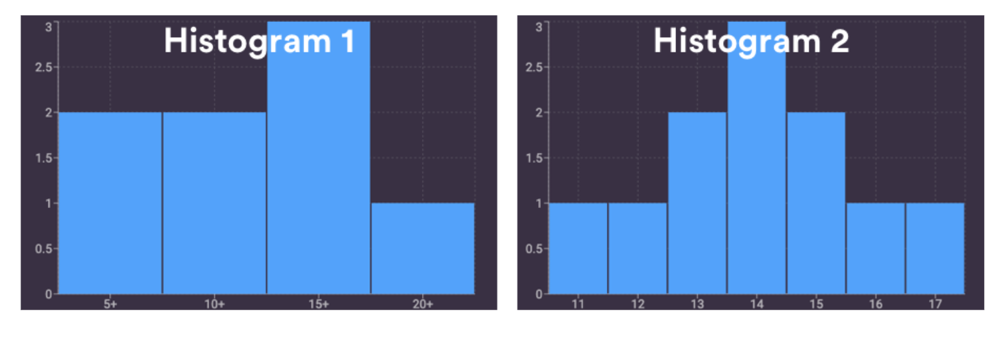
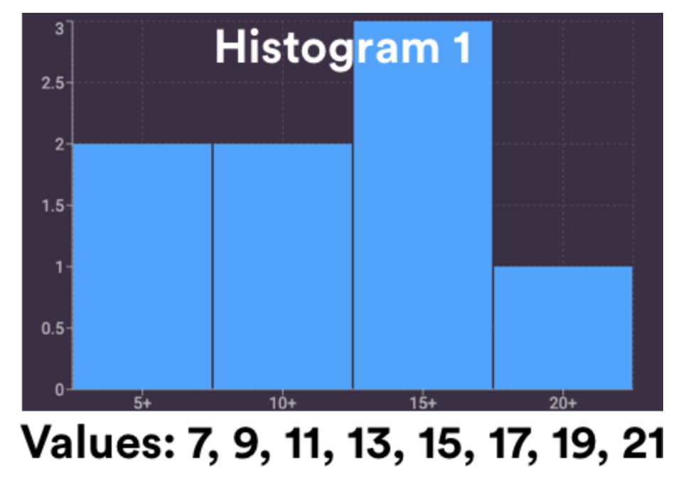
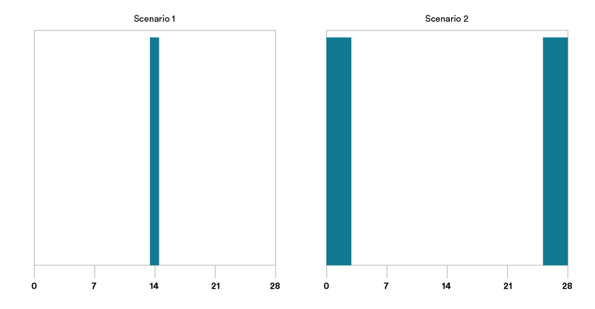
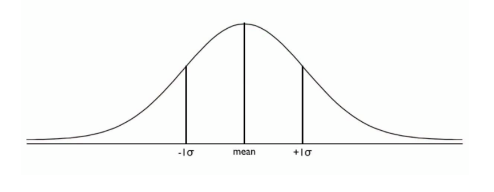

<h1>
  Math Pre-Work
  Measures of Center and Spread
</h1>

## Measures of Center and Spread ( 30 min )

Goldilocks wanted a bed that was not too hard, or too soft, or too hot, or too cold. Like Goldilocks, you might want to find that value that’s right in the middle. But when you’re dealing with a large, complex data set, that can be more complicated than it sounds. In this lesson, we’ll dive into the statistics that will help you see the range of options and find where “center” actually is.

## Topics

- Descriptive and Inferential Statistics
- Measures of Center and Spread
- Standard Deviation and Range
- Outliers

### **Learning Objectives**

By the end of this lesson, you'll be able to:

- Identify the difference between descriptive and inferential statistics.
- Explore calculating basic measures of spread.

## Descriptive Statistics

*“Most people check their phones 58 times a day.”*

*“Customers who switch to our insurance save &#36;200 a year on average.”*

*“This was the coldest winter on record.”*

How would you begin to make sense of this data?

The reality is that you’ve been given bits of information in the form of descriptive statistics your entire life, but you may not have thought about it in those exact terms.

**Descriptive statistics** focus on summarizing, describing, and understanding the data we observe.

## Descriptive Statistics IRL

Let’s say you’re a marketing analyst for [Etsy](https://www.etsy.com/), a website where people can purchase artisanal products.

You have data detailing how many purchases have been made per hour over the past six months.

Your manager is eager to hear how shopping numbers have been, so you want to share the data you’ve collected. You could recite every hourly total and come to a fuzzy conclusion about what purchasing habits *generally* look like. But your manager doesn’t have time for you to list out all of those numbers.

Instead, you could describe your data with certain kinds of numbers that will quickly get your point across: **measures of center** and **measures of spread**.

First, we’ll talk about measures of center.

## What Are Measures of Center?

Measures of center are exactly what it sounds like: Ways to describe the middle (i.e., measure the center) of your data.

It turns out that there are a few different ways to describe the middle of your data. We’ll cover the three most common here: **mean**, **median**, and **mode**.

## Measures of Center

[TODO] - Video

### Measures Of Spread

You’ve now navigated measures of center by calculating the most common ways to describe the middle of your data set: mean, median, and mode. Congrats! 🎉

But does this tell the whole story? Not quite.

It’s as if you read the plot summary of a movie on Wikipedia. You’d know a lot about the movie, but not *everything*. We’re doing something similar here — taking our full data set (the movie) and condensing it down to a summary (the Wikipedia post).

We can get a more complete picture of the story if we calculate our measures of center along with **measures of spread**.

## Visualizing Measures of Spread

Think back on our Etsy scenario — examining how many purchases have been made every hour over the past six months. It’s not enough to just share the mean or median, because those numbers don’t tell the whole story!

For example, both of these histograms have a mean and median that are exactly 14:

 

Your manager, when faced with these data sets, might make different decisions about how to proceed. We want more information than just the measures of center.

**Measures of spread** — range, standard deviation, and variance — can help us understand how dispersed (spread out) our data is.

### Range

**Range** is an easy way to measure the spread of your data.

We find the largest and smallest values in our data, then calculate the difference between the two.

Let’s use Histogram 1 as an example:

 

If we wanted to calculate the range here, 21 (the largest value) - 7 (the smallest value) = **14** (the range).

## Standard Deviation

Another way to measure the dispersion in our data is to calculate the **standard deviation**. Standard deviation, denoted σ (“sigma”), is approximately the average distance of every data point from the mean.

Two factors to keep in mind when determining standard deviation:

- **Low standard deviation**: The mean is close to zero and the data isn’t very spread out.
- **High standard deviation**: The mean is far from zero, and there is a lot of spread in our data.

 

In Scenario 1, our standard deviation is exactly zero! The behavior of our shoppers doesn’t deviate at all; each hour has the exact same results.

In Scenario 2, different hours reflect different shopping patterns. Our data is more spread out than in the first scenario, which helps us better understand our data.

### Walk-Through: Calculating Standard Deviation

The formula for the standard deviation of a data sample is:

$$\sigma = \sqrt{\frac{\sum\limits_{i=1}^{n} \left(x_{i} - \bar{x}\right)^{2}} {n-1}}$$

Let’s walk through the steps of this formula to find the standard deviation for the data set [3, 4, 5].

1. Calculate the mean.
2. Take the difference of each observation and the mean.
3. Square each result from Step 2.
4. Sum each result from Step 3.
5. Divide the result of the previous Step by $(n−1)$, where $n$ is the number of observations.
6. Take the square root of this result.

Before scrolling down, try to calculate these totals yourself!

## Calculating Standard Deviation — Solved!

Here are our results:

1. Calculate the mean. **The mean is 4**.
2. Take the difference of each observation and the mean. **The differences are -1, 0, and 1**.
3. Square each result from Step 2. **The squared results are 1, 0, and 1**.
4. Sum each result from Step 3. **The sum is 2**.
5. Divide the result of the previous step by $(n−1)$, where $n$ is the number of observations. **2 / (3-1) = 2/2 = 1**.
6. Take the square root of this result. **The square root of 1 is 1**.

The standard deviation of the data set [3, 4, 5] is **1**.

Our mean value is **4** and our lowercase sigma represents **one standard deviation** to the right or left of the mean.

 

### Variance

Fun fact: Had we stopped at Step 5, we would have found the **variance**: 
a rough idea of how spread out our data is.

So, in our walk-through example...

1. Calculate the mean.
2. Take the difference of each observation and the mean.
3. Square each result from Step 2.
4. Sum each result from Step 3.
5. Divide the result of the previous step by $(n−1)$, where 
$n$ is the number of observations. **2 / (3-1) = 2/2 = 1 (the variance)**.

Variance is very similar to standard deviation and is seen frequently throughout data science. The smallest a variance gets is zero, but it can be infinite with numbers in the millions or billions (and beyond).

However, one downside of using variance is that our units are squared! In our example above, the number 2/3 here means 2/3 visitors squared. That doesn’t mean anything in the real world!

## Outliers

Measures of center and spread aren’t just used to quickly communicate important information about your data.

They can also be used to identify extreme points that fall far outside the pattern of your data.

For example, suppose we have this data set, reflecting the number of purchases made each hour:

    [11, 12, 13, 13, 14, 14, 14, 15, 15, 16, 17] 
    
Suppose that, in the next hour, the number 41 was added to this data set, indicating that 41 purchases had been made.

We might refer to the value of 41 as an **outlier**.

## Navigating Outliers

**Outliers** are numbers that fall beyond the pattern of our data.

It may be important for us to consider outliers because they can have severe implications on business decisions!

For example...

- If there were 41 purchases in an hour, do we need to order more product sooner than we thought?
- Was our marketing team doing something differently that we should continue doing?
- Is it possible that 41 was simply a typo, and it actually meant 14 people?

While there’s no one prescribed way to identify and handle outliers, there is one common way to spot potential outliers that involves the mean and standard deviation.

### How to Identify Outliers

One way to identify potential outliers involves calculating the mean and the standard deviation.

Take our data from earlier:

    [11, 12, 13, 13, 14, 14, 14, 15, 15, 16, 17, 41]
    
The mean of this data is **16.25** and the standard deviation is about **7.6**.

Any points that fall below the mean minus three times the standard deviation or any points that fall above the mean plus three times the standard deviation may be considered outliers.

$16.25 - 3 * 7.6 = -6.55$

$16.25 + 3 * 7.6 = 39.05$

Any points below -6.55 or above 39.05 may warrant further investigation, as they may be outliers!

### Up Next...

After some knowledge checks we will look at Measures of Center and Spread.