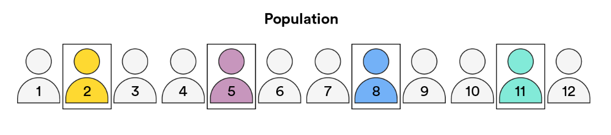
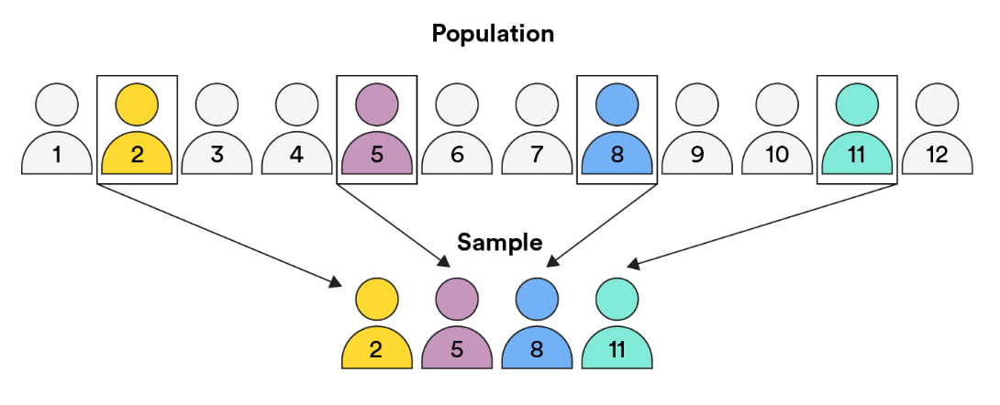
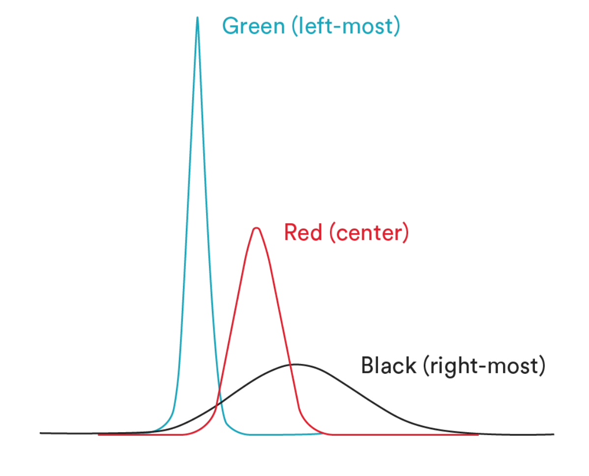
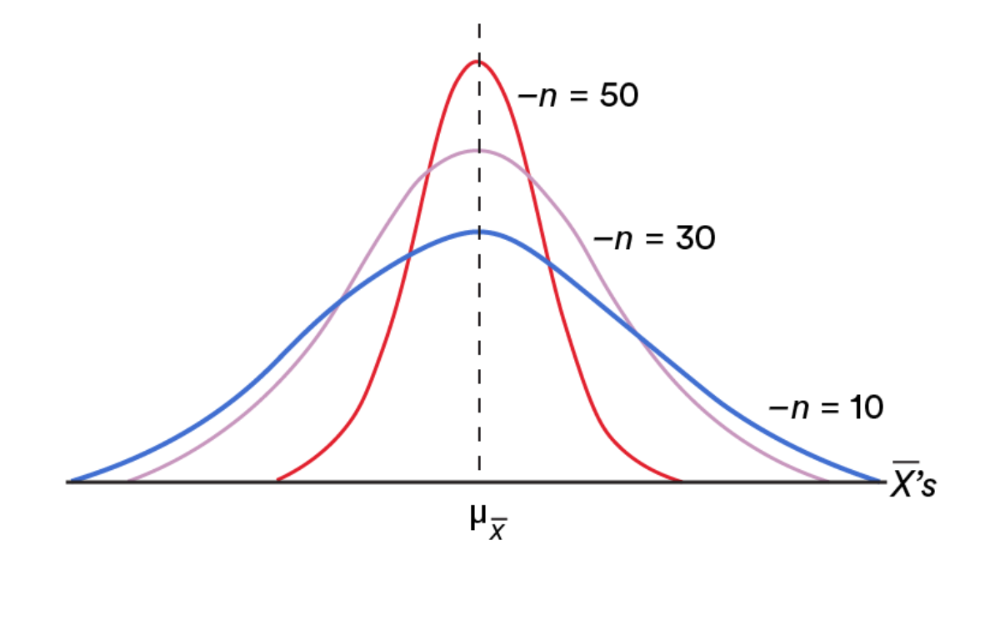
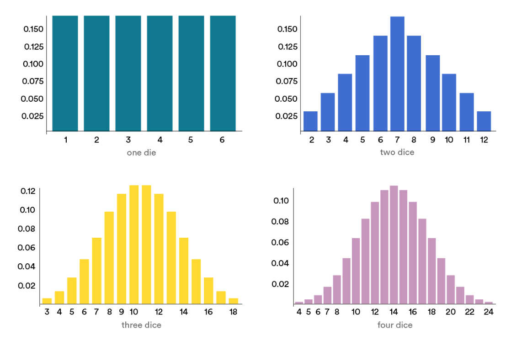
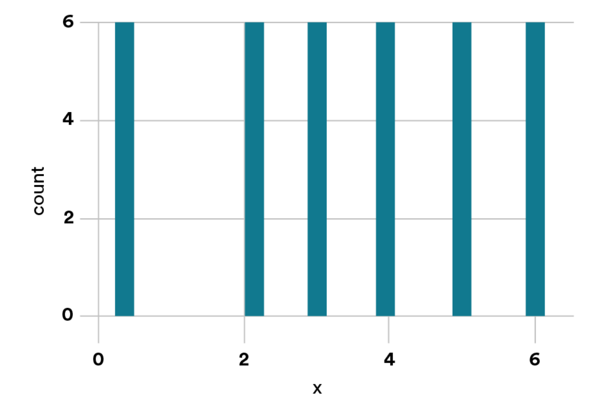

<h1>
  Math Pre-Work
  Central Limit Theorem
</h1>

## Central Limit Theorem ( 35 min )

*author: [Matt Brems](https://www.linkedin.com/in/matthewbrems/) | Lead Instructor, Data Science Immersive, Washington, D.C.*

----
 

The central limit theorem (CLT) is at the core of making inferences about large data sets — a primary part of the job of a data scientist. In this lesson, you’ll explore how CLT helps us explore and understand what’s happening under the hood: the story behind the data.

## Topics

- Central Limit Theorem
- Distributions

### **Learning Objectives**

By the end of this lesson, you'll be able to:

- Explore the statistical implications of the central limit theorem.
- Identify how and why you would sample a population.

## Symbols To Look Out For

During this lesson, you'll see some new and unusual mathmatical symbols, but never fear! GA is here to help...

**Symbol Key**

- Data: $X$

- Sample mean: $\overline{x}$

- All possible sample means: $\overline{X}$
 
- Variable: $n$

- Mean of first sample: $\overline{x}_1$

- Mean of second sample: $\overline{x}_2$

- Mean of third sample: $\overline{x}_3$

## Inferential Statistics

Let’s say you work for a polling company. You’re interested in understanding the landscape of voters for an upcoming election.

It’s not exactly efficient to survey the preferences of the entire U.S. population, so you choose to collect data from a group of 100 people.

Does that data tell the whole story of all voters? No, not really. But you, being the savvy data scientist that you are, can make an *inference* based on the data you do have.

Enter **inferential statistics**, where we focus on generalizing results from a sample to a larger population.

## Populations

To start determining voter trends and preferences, you may want to get to know your target audience, such as all individuals who will vote in an upcoming election.

That group of people? That’s your group of interest — your **population**.

 

### Samples

Now, let’s say you want to take a closer look at this population to see which individuals tend to respond to questions about their voting preferences.

That’s your **sample** — a subset of the population.

 

Using the mean of this sample, or the **sample mean**, implies that you can use that smaller sample to draw conclusions about the larger population.

When we calculate a sample mean ($\overline{x}$), we treat it as one observation from the distribution of all possible sample means ($\overline{X}$).

## Normal Distribution

Lots of real-world phenomena follow a **normal distribution**: data near the mean occurring more frequently than data that is further from the mean.

If we know that $\overline{X}$ follows a normal distribution, we can then rely on this when conducting inference on a sample mean.

Take a look at this figure reflecting **three normal distributions**. It highlights how normal distributions typically appear — symmetrical around their mean, denser in the center, and less dense around the tails.

1. **Green (left) distribution**: Has a mean of **-3** and a standard deviation of **0.5**.
2. **Red (middle) distribution**: Has a mean of **0** and a standard deviation of **1**.
3. **Black (right) distribution**: Has a mean of **2** and a standard deviation of **3**.

 

### Central Limit Theorem

How can we be sure that an assumption of normal distribution is accurate?

We turn to the **central limit theorem**.

The central limit theorem ensures the data ($X$) is accurate, whether or not the sample size distribution of data is normal and regardless of the distribution of the original data.

As the sample size increases, the margin of error decreases — no matter the shape of the population distribution. This is especially true for sample sizes of more than 30. The more samples you take, especially large ones, the more your graph of the sample means will look like a normal distribution.

## Sampling Distribution

Suppose we take a sample of $n$ observations from a population and record the mean of this sample.

We then replace all observations, pull another sample of $n$ observations from the same population, and record the mean of *that* sample.

Now, say we do this over and over again until we’ve recorded the mean of every possible sample of size $n$ from the population. This is known as the **sampling distribution** of $\overline{X}$.

### Central Limit Theorem in Practice

Let’s take a closer look at the central limit theorem and sampling distribution.

In the example below, we can see that as the sample size gets larger, the graph approaches a more normal distribution.

If $n$ is larger than $30$, then $\overline{X}$ is sufficiently close to normal. The larger the value of $n$, the better basis you’ll have for decision-making.

 

## Visualizing the Central Limit Theorem

Take a look at these four histograms and what they represent:

- **One die**: Distribution of the sample mean for all possible samples of size $1$.
- **Two dice**: Distribution for samples of size $2$.
- **Three dice**: Distribution for samples of size $3$.
- **Four dice**: Distribution for samples of size $4$.

Notice that, as $n$ increases, the distribution becomes more normal.

 

## Exploring the Central Limit Theorem

Let’s look at another example:

Suppose you roll a six-sided die. You roll it once and get a 5.

If you were to calculate the average of that roll, that average would be 5. We’d indicate this with $\overline{x}1=5$, saying that the mean of our sample is 5.

You decide to roll again, and this time you get a 3.

The mean of this second sample ($\overline{x_2}$) is **3**.

## Exploring the Central Limit Theorem (Cont.)

Let’s do this again, but instead use sample size $n=2$. In this case, we’ll roll the die twice and find the average:

$$Sample\ 1:\{1,1\}⟹ \overline{x_1}=1\\
Sample\ 2: \{1,2\}⟹ \overline{x_2}=1.5\\
Sample\ 3: \{1,3\}⟹ \overline{x_3}=2\\
...\\
Sample\ 36 :\{6,6\}⟹ \overline{x_{36}}=6$$

## More on the Central Limit Theorem

What if we were to do this for every possible sample of size 1? That would mean rolling a 1, 2, 3, 4, 5, and 6 exactly once each.

We’d use the random variable ($\overline{X}$) to represent all possible values of the sampling distribution ($\overline{x}$), along with how frequently we observe the sample mean of those values.

If we were to visualize this with a histogram, we get a flat chart in which values 1 through 6 are all equally likely.

 

### Experimental Design

What would you do to ensure that your means of data collection, or your experiment, has been handled in the right manner?

**Experimental design** is concerned with validity, reliability, and replicability. It ensures that:

1. The question the experiment is trying to answer is clearly defined.

2. Sources of variability in the experiment are identified.

3. Descriptions exist of how participants were allocated — i.e., if they were randomly chosen or other methods were used.

## Experimental Design IRL

In data science, **sample protocol** is an important part of dealing with survey data (or *experiments*). Statistical significance should always be used when making decisions based on data, but it’s also important to consider *the types of questions being asked* and *who is answering them*.

For example, customers with bad experiences may be more likely to write reviews on a website than those with good experiences. Therefore, this does not necessarily mean that users are having more negative experiences than positive ones! Instead, it suggests that the results are biased toward dissatisfied customers.

If you know your data set contains biased answers, it’s up to you to decide how to deal with the data so that you can still get meaningful results.

## Wrap up

We’ve reviewed how to calculate, visualize, and analyze data using the central limit theorem. As you move throughout the course using sample data sets to estimate characteristics about large populations, recalling the central limit theorem will come in handy.

## Up Next...

After some knowledge checks we will look at Rules of Probability.