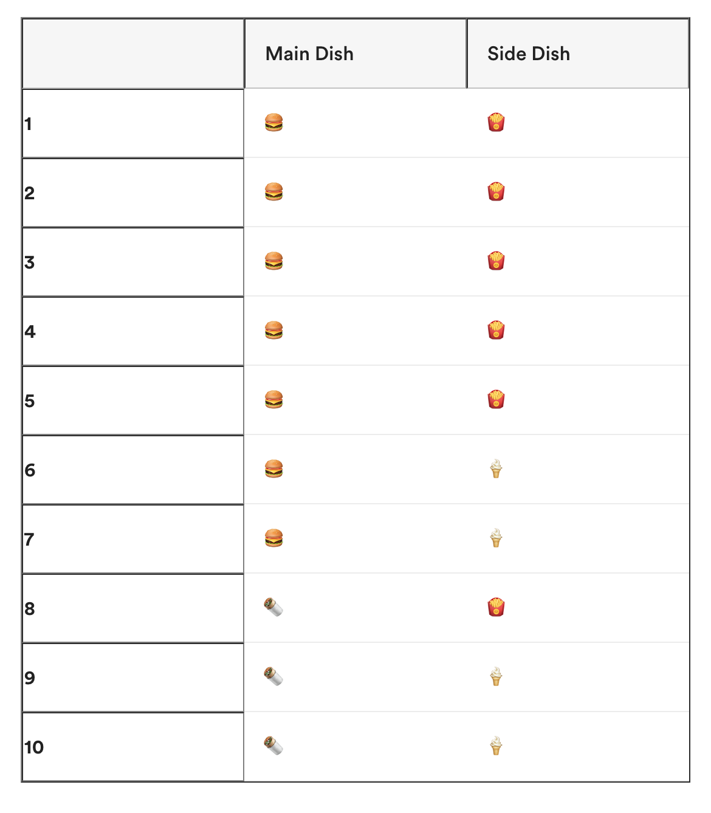

[TODO] in general need the popups for incorrect responses as well.

## Raandom Variables

### Knowledge Check

Which of the following is an example of a continuous value?

Select the best answer.

- Incorrect: The number of home runs hit by Babe Ruth.

- Correct : The volume of water in all the earth's oceans. (Because volumne is a measurement, this is indeed a continuous value.  We can always increase the decimal place to which the volume is measured to improve its accuracy.)

- Incorrect: The number of employees in a company.

- Incorrect : The number of grains of sand on earth.

### Knowledge Check

Which of the following random variables are correctly labeled as “CONTINUOUS” or “DISCRETE”?

Select all that apply.

[TODO]

Correct: That’s right! All of these are labeled correctly except for, “The length of a shadow cast by a willow tree.” This is a continuous variable, as we can always increase the decimal place to which the length is measured to improve its accuracy.

### Knowledge Check

Which of the following is an example of a discrete variable?

Select the best answer.

[TODO]

### Knowledge Check

What is the expected value of $x$?

[TODO]- image

Select the best answer.

- Incorrect: 0.35
- Incorrect: 0.75
- Incorrect: 1.5
- Correct: 1.1  The expected value of $x$ is 0+1(0.35)+2(0.15)+3(0.15) = 1.1

### Knowledge Check

Continuous data comes from quantities that can be ____________.

Select the best answer.

- Correct: Measured.  Continuous variables can be measured, while discreet variables can be counted
- Incorrect: Counted
- Incorrect: Both

### Knowledge Check

Which of the following is *not* an example of continuous data?

Select the best answer.

[TODO]

### Knowledge Check

You decide to collect several bottles of water and measure the volume of water each contains. Let $x$ be the number of milliliters of water in each bottle. What type of variable is $x$?

Select the best answer.

[TODO]

## Measures of Center and Spread

### Knowledge Check

What is the mean of the following values:

[13, 18, 13, 14, 13, 16, 14, 21, 13]

Select the best answer.

- Incorrect: 18
- Incorrect: 14
- Correct: 15
- Incorrect: 13

Correct:
(13+ 18+ 13+ 14+ 13+ 16+ 14+ 21+ 13)/ 9 = 15

### Knowledge Check

What’s the median in this set?

        [13, 13, 13, 13, 14, 14, 16, 18, 21]
Select the best answer.

- 14 (Correct)
- 13
- 18
- 21

Correct: If we line up these values from smallest to largest, we find the middle-most value is 14.

### Knowledge Check

What’s the mode in this set?

       [13, 18, 13, 14, 13, 16, 14, 21, 13]                       
Select the best answer.

- 14
- 16
- 13
- 21 (correct)

Correct: The value we see most often is the 13.

### Knowledge Check

What are the data types of `+42`, `1`, `False`, and `float(False)`, respectively?

- int, bool, bool, float
- int, int, bool, bool
- int, float, bool, bool
- int, int, bool, float (correct)

The built in float() function converts the value passed in into a float. Note that 1 by itself is an int, even though True is internally represented as 1.

### Knowledge Check

What is the variance of the values [4, 10, 16]?

Select the best answer.

[TODO]

### Knowledge Check

Suppose that we had **3** purchases at 9:00 this morning, **4** purchases at 10:00, and **5** purchases at 11:00.

This makes a data set of [3, 4, 5]. We want to calculate the standard deviation for this data.

If we want to find the distance from each data point to the mean, we first have to calculate the mean. Which of these options represents the mean?

Select the best answer.

- Correct: 4
- Incorrect: 2
- Incorrect: 7

### Knowledge Check

Given the following data set:

[11, 12, 13, 13, 14, 14, 14, 15, 15, 16, 17]

Mean = 14

Standard deviation = 1.65

Which points (if any) warrant further investigation as potential outliers?

Select the best answer.

[TODO]

## Central Limit Theorem

### Knowledge Check

Suppose you have the following variables:

- $X$ = A random variable representing the blood pressure of everyone in one country.
- A sample size of 50 individuals.
- $\overline{X}$ = The mean of this sample’s blood pressure.

If we know that blood pressure ($X$) follows a normal distribution, then we know that the sampling distribution of $\overline{X}$ follows a normal distribution as well.

If we **don’t** know that blood pressure ($X$) follows a normal distribution, can we assume that the sampling distribution of 
$\overline{X}$ is approximately normally distributed?

Select the best answer.

- yes: correct
- no: incorrect

correct: Yes we can!  If we don't know that blood pressure $X$ follows a normal distribution, we can assume that the sampling distribution of $\overline{X}$ is approximately normally distributed, because our sample size is greater than 30.  We can apply the central limit theorem here.

### Knowledge Check

We want to estimate the average age among our coworkers. We sample 25 individuals and ask them their age. We don’t know if the population of age would follow a normal distribution.

Which of the following statements is true?

Select the best answer.

[TODO]

### Knowledge Check

If we visualize the distribution of rolling a die six times and getting 1, 2, 3, 4, 5, and 6 exactly once, the histogram would be...

Select the best answer.

- Normally distributed
- Round on the sides but flat on top
- Flat (correct)
- Skewed to the right

Correct: If we were to roll a die six times and get each number exactly once, the histogram will be flat.  As we increase the number of rolls, the shape of the distribution will become more normal and eventually reach the central limit theorem.

### Knowledge Check

We want to test if 66 inches is a reasonable guess for the average height of employees at our company. We know that the employees' heights follow a normal distribution and we sample 15 people for the test.

Which of the following statements is **true**?

Select the best answer.

- We do not need to apply the central limit theorem (correct)
- We need to apply the central limit theorem


Correct: We do not need to apply the central limit theorem because our original data is normally distributed, and the sampling distribution will be approximately normally distributed, regardless of sample size.


## Rules of Probability

### Knowledge Check

Does `my_set_1.union(my_set_2)` yield the same result as `my_set_2.union(my_set_1)` ?

Select the best answer.

- Yes, it does! (correct)
- No, it doesn't!

Correct: Set union is order-invariant (symmetric).

### Knowledge Check

Does `my_set_1.intersection(my_set_2)` yield the same result as `my_set_2.intersection(my_set_1)` ?

Select the best answer.

- Yes, it does! (correct)
- No, it doesn't!

Correct: Set intersection is order-invariant (symmetric).

## Knowledge Check

Which of the following are *true* about the rules of probability?

Select all that apply.

- Correct: An event's probability must be greater than or equal to zero.
- Incorrect: The total probability of an outcome must be greater than one.
- Correct: The probability of a union of two mutually exclusive events is the sum of the probabilities of the individual events.
- Incorrect: The probability of a union of two mutually exclusive events is the product of the probabilities of the individual events.

Correct: There are three axioms of probability:

1. The probability of an event cannot be negative.
2. The probability of an outcome occurring in the sample space is one.
3. The probability of a union of two events is the sum of the probabilities of the individual events.

## Knowledge Check

What is the marginal probability that you will be selected for a bag search (and risk losing your jar of peanut butter)?

Select the best answer.

- 5.7% (correct)
- 8.6%
- 17.1%
- 2.9%

Correct: From our sample group of 35 people, two were searched, so we'd have 2/35 = 0.057

## Knowledge Check

What is joint probability?

Select the best answer.

- The likelihood of a single random event occurring.
- The likelihood of a single non-random event occurring.
- The likelihood of two random events occurring together. (correct)
- The likelihood of two non-random events occurring together.

correct: great job!

## Knowledge Check

Repeat the burger joint example, but find the conditional probability that a customer who orders a veggie wrap (🌯) will also order fries (🍟):



Select the best answer.

- 28.6%
- 33.3% (correct)
- 66.7%
- 71.4%

correct: P(fries|veggiewrap) = 0.1/0.3

## Functions in Python

### Knowledge Check

Observe the Python function below.

If we call this function with `calculator("*", 10, 5)`, what will be the output?

```python
def calculator(operation, value1, value2):
    if operation == "+": return value1 + value2
    if operation == "-": return value1 - value2
    if operation == "*": return value1 * value2
    if operation == "/": return value1 / value2
```

Select the best answer.

- 15
- 5
- 2
- 50 (correct)

### Knowledge Check

Check out the `compound()` function below.

```python
def compound(word1, word2):
    return word1 + word2
```

What would we need to write in order to get a return value of `'bookshelf'`?

Hint: Our arguments are strings.

Select the best answer.

- `compound('book', 'shelf')` (correct)
- `compound(book + " " + shelf)`
- `compound(book, shelf)`
- `compound('book' + " " + 'shelf')`

### Knowledge Check

You begin writing a function that’s designed to multiply two numbers together:

```python
def multiply(a, b):
    output = a * b
```

You want to assign the output number to a variable, like so: `var = multiply(3, 4)`. What line needs to be added to the function to make `var` the output number?

Select the best answer.

- return output (correct)
- return: output
- print(output)
- return

## Objects in Classes

### Knowledge Check

Recall that a class is essentially the blueprint of a provided object, which is created using the process of instantiation.

Imagine that you are working with music data and you want to define a class to represent a band. The class should have two attributes that describe the object being assigned to that class — the name of the band (`band`) and the band’s genre (`genre`).

Task: For this challenge, write the code needed to define a class for a band, initiate it for the band Queen, and fill in the `give_stats()` method to have it return a string in the following format: `band: Queen genre: Rock`

Hint: You call the string method `.format()` within the `give_stats()` method to help you return the full set of information.

Enter your response using Python 3.6.

[Open Code Response]

### Knowledge Check

You would like to define a class called Bird() that inherits from a class called Animal(). What is the correct syntax for the first line of the class definition?

Select the best answer.

- `def Bird(Animal)`
- `class Bird from Animal`
- `class Bird(Animal)` (correct)
- `Class Animal(Bird)`

Hint: Class is lowercase and the parent class is put in the parentheses following the name of the defined class.

### Knowledge Check

Consider the following class definition for `Cat()`:

```python
class Cat(Animal):
    def __init__(self, name='Lucky'):
        self.name = name
```

How would you instantiate a `Cat()` object with a `name` attribute of `'Furball'`?

Select the best answer.

- `mycat = Cat(name='Furball')` (correct)
- `furball = Cat()`
- `mycat = Cat(self, name='Furball')`
- `mycat = Cat.init(name='Furball')`

Hint: The `__init__()` function is automatically called when we create an object with the `Cat(name='Furball')` syntax

### Knowledge Check

Which of the following statements are true of the `self` argument in class definitions?

Select all that apply.

- Correct : The user does not need to supply `self` when using instance methods, only when defining them.
- Correct : The `self` argument is a reference to the instance object.
- Incorrect: Any variable assigned with `self` (e.g. `self.var`) will be shared across instances of the class.
- Incorrect: With an instance, `obj`, entering `obj.self.var` will provide the value of `var` for that instance

Hint: `self` is automatically passed into an instance method when you call it. It refers to the instance, and not the class. `self.var` will not be shared between instances, as `self` refers only to the specific instance.


## Error Handling in Python

### Knowledge Check

Consider the following code:

```python
for i in 1 to 10:
    print(i)
```

Which of the following error types will occur?

Select the best answer.

- TypeError
- SyntaxError (correct)
- NameError
- ValueError

### Knowledge Check

You are writing a function that adds numbers together. The output should only be a positive number or zero. If it isn’t, you would like to throw a `ValueError`:

```python
def positive_only(a, b):
    output = a + b
    if output >= 0:
        return output
    else:
        # Your code here.
```

What code should be placed in the `else` statement to give a `ValueError`?

Select the best answer.

- throw ValueError
- raise ValueError (correct)
- return ValueError
- except ValueError

Hint: To throw an error to a user use the `raise` keyword followed by the error type.