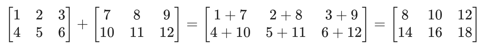
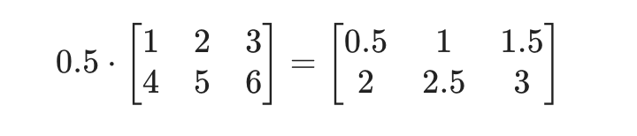
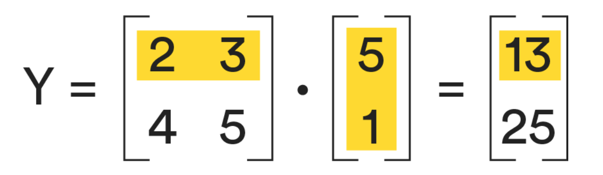
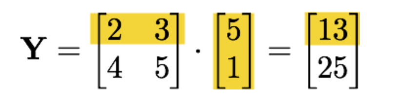

<h1>
  Math Prework
  Matrix Operations in Python
</h1>

## Matrix Operations in Python ( 30 min )

*author: [Dan Wilhelm](http://danwilhelm.com/) | AI & Data Science Consultant*

----
 

You see matrix operations everywhere. All of the memes made through Adobe Photoshop use matrices to process linear transformations to render images. In this lesson, we’ll learn to work with matrices as another foundation that will help us perform linear regression data science models.

## Topics

- Matrices
- Matrix Indexing
- Row and Column Vectors

### **Learning Objectives**

By the end of this lesson, you'll be able to:

- Describe the difference between vectors and matrices.
- Explain the concept of a matrix inversion.
- Apply systems of linear equations to sample data.

## What’s a Matrix, You Ask?

When we refer to a “matrix” in this lesson, we’re not talking about that 1999 sci-fi flick.

Rather, a **matrix**, or matrices, are the building blocks of data science. They’re mathematical structures — underlying principles of linear algebra — that are used to model data for machine learning.

For example, in robotics and automation, matrices are the basic components for robot movements.

## Matrix Indexing

Think about how a spreadsheet is organized in rows and columns. Matrices are sort of organized like that: a collection of numbers arranged in a basic, spreadsheet- or array-like way. This is what’s called **matrix indexing**.

When indexing matrices:

- Always write rows first, followed by columns.
- Start indexing at 1 (most programming languages start with 0).
- Denote matrices with bold capital letters (e.g., **X**) to distinguish between a matrix and a coefficient (which is typically written in italics).

So, an $m$-by-$n$ matrix is a matrix containing $m$ rows and $n$ columns. It looks something like this:

$$
\mathbf{X}=
\begin{bmatrix}
x_{11} & x_{12} & x_{13} &...& x_{1n}\cr
x_{21} & x_{22} & x_{23} &...& x_{2n}\cr
...&...&...&...&... \cr
x_{m1} & x_{m2} & x_{m3} &...& x_{mn}
\end{bmatrix}
$$

## Row Vectors

What do matrices usually represent?

In data science, we often create matrices in which each row represents a data point (a record or sample) and each column represents a feature of those data points.

This lets us think about a matrix as an ordered list of data points, much like a vector is an ordered list of scalars. If we take a look at a single data point in that matrix, it has dimensions of 1-by-$n$ and is called a **row vector**.

## Column Vectors

We can also take a column from a matrix. This is called a **column vector**. In the context of our data, this would be all of the values of a given feature. So, given our athlete data points matrix:

$$
\mathbf{A}=
\begin{bmatrix}
24 & 180 & 1\cr
22 & 185 & 1\cr
18 & 140 & 0\cr
17 & 145 & 0
\end{bmatrix}
$$

The vector that contains only the athletes’ weights is:

$$
\mathbf{w}=
\begin{bmatrix}
180\cr
185\cr
140\cr
145
\end{bmatrix}
$$

As with row vectors, column vectors are also vectors — they’re ordered lists of scalars.

## Row and Column Vectors in Action

Here’s some athlete data, represented as a 4-by-3 matrix with the feature columns `age`, `weight`, and `swimmer=1/gymnast=0`:

$$
\mathbf{A}=
\begin{bmatrix}
24 & 180 & 1\cr
22 & 185 & 1\cr
22 & 185 & 1\cr
17 & 145 & 0
\end{bmatrix}
$$

The third row/athlete is the 1-by-3 row vector:

$$
\mathbf{a_3}=
\begin{bmatrix}
22 & 185 & 1
\end{bmatrix}
$$

For example, this may be a past record for Olympic swimming champ Michael Phelps — he was 22 years old, 185 lbs, and a swimmer (1).

## Transposition

Let’s say you want to turn a row vector into a column vector. You could do this by **transposing** it. This is represented by a $T$ symbol.

For example:

$$
\mathbf{A^T}=
\begin{bmatrix}
1 & 2\cr
3 & 4\cr
5 & 6
\end{bmatrix}=
\begin{bmatrix}
1 & 3 & 5\cr
2 & 4 & 6
\end{bmatrix}
$$

Often, column vectors are written as transposed row vectors so the vectors can be written more conveniently in a line of text.

## Addition and Subtraction of a Matrix

Matrices, just like normal numbers, can be added, subtracted, and multiplied.

For the matrix addition of two matrices of equal dimension — often called **element-wise addition** — you have to sum each corresponding element.

Here’s a look at adding two matrices of equal dimension:

 

If you’re adding two matrices with unequal dimensions, your final result of the addition is undefined. The same goes for subtraction.

## Matrix Multiplication By Scalar

If a matrix is multiplied by a scalar, then each element is multiplied by that scalar. This is often called **element-wise multiplication**. The final matrix will have the same dimensions as the original.

For example:

 

Matrix division by a scalar is defined similarly.

### Matrix Multiplication

**Matrix multiplication** is only defined when the left matrix has the same number of columns as the right matrix has rows.

Suppose we have an $m$-by-$n$ matrix, $\mathbf{A}$, and an $i$-by-$j$ matrix, $\mathbf{B}$. Matrix multiplication will only be defined if $n=i$, which will result in a matrix of $m$-by- $j$.

Thinking about matrices in this way demonstrates that matrices can represent linear equations.

Here’s how we might represent matrix multiplication as a formula. For $\mathbf{X}=\mathbf{A}\mathbf{B}$ where $\mathbf{A}$ has $n$ columns, the $i$th row and $j$th column of $\mathbf{X}$ are given as:

$$
\mathbf{X_{ij}}=\displaystyle\sum_{k=1}^n A_{ik}B_{kj}= A_{i1}B_{1j}+A_{i2}B_{2j}+ ...+ A_{in}B_{nj}
$$

A **dot product** is the result of multiplying two matrices together. This is a good term to recall as you move through the course.

## More on Matrix Multiplication

Let’s try an example in which we’ll evaluate two linear equations at once to try and understand why matrix multiplication is defined as it is.

Here are our two equations: $y_1=2x+3$ and $y_ 2=4x+5$.

We want to evaluate both equations given $x=5$, so we should get $2×5+3=13$ and $4×5+5=25$. We’ll construct a matrix for the coefficients: a 2-by-2 matrix will hold $[2 \quad 3]$ in Row 1 and $[4 \quad 5]$ in Row 2.

The column vector will be the same as before: our desired $x=5$, along with the constant
 $\begin{bmatrix}1\cr 5\end{bmatrix}$.
 
Let’s visualize this:

 

We have a 2-by-2 matrix multiplied by a 2-by-1 matrix, yielding a 2-by-1 matrix (outer-by-outer). To get Row 1, Column 1 of the result, we take the dot product of the first row in the left matrix with the first column in the right matrix. To get Row 2, Column 1 in the result, we take the dot product of the second row in the left matrix with the first column in the right matrix.

### Matrix Multiplication: Squared Error

Applying the previous formula’s predictions to the actual data of athletes, we find the formula was wrong, or in error, by the following amounts:

$\mathbf{e}= [1\quad 3\quad 0]$

Let’s find the sum of the squared errors using linear algebra. To do this, note that the dot product of a vector by itself is the sum of its squared elements. For example,

$[3\quad 10]\cdot[3\quad 10]=3\times3+10\times10=109$

So, we just have to multiply the final vector by its transpose to get the sum of squared errors:

$$
\mathbf{e}\cdot\mathbf{e^T}=[1\quad 3\quad 0]\begin{bmatrix}1\cr 3\cr0\end{bmatrix}=[10]
$$

## Matrix Multiplication: System of Equations

A common use of matrices is storing the coefficients of mathematical formulas. Let’s see what this looks like in a general sense, using the last multiplication as a reference:

 

This is a new way of thinking about matrices. Instead of just storing data points, we’re now using matrices to store systems of equations.

- $\mathbf{m}$: Number of equations.

- $\mathbf{n}$: Number of features/coefficients (excluding the bias).

- $\mathbf{n+1}$: Number of features/coefficients (including the bias).

In this case, we have an $m$-by-$(n+1)$ matrix of coefficients, $\mathbf{A}$ (the $+1$ includes the one constant for the bias), an 
$(n+1)$-by-$1$ column vector of $n$ variable values, $\mathbf{x}$ (again, $+1$ for the one constant), and an $m$-by-$1$ column vector, $\mathbf{b}$, of one result per equation. The linear algebra equation for this looks like:

$\mathbf{Ax}=\mathbf{B}$

Note that our predicted data points have the independent variable values from the $\mathbf{x}$ column vector and the corresponding predicted $y$ values from the $\mathbf{b}$ column vector. If we were predicting the results of multiple variables, the $\mathbf{b}$ could be a matrix.

Make sure you understand how $m$ and $n$ relate to the figure. Trace through the two dot products again and visualize the linear equations being computed algebraically. Can you extend it to three equations? Can you figure out how to have it make predictions for multiple data points? How might you expand our notion of matrix multiplication to do this?

## Wrap up

Nice work! As you move through the Immersive and start using the NumPy library, you’ll get more familiar with using it to create a matrix.

If you’re interested in gaining more practice with this topic, check out the following resources:

- [Matrix Introductions](http://www.mathsisfun.com/algebra/matrix-introduction.html)
- [Matrix Multiplication](http://www.mathsisfun.com/algebra/matrix-multiplying.html)
- [Matrix Inverse](http://www.mathsisfun.com/algebra/matrix-inverse.html)

## Up Next...

After some knowledge checks your next module is The Programmer's Tools.

 

<a href="./assets/matrix-operations-in-python.pdf" target="_blank" download="matrix-operations-in-python.pdf" class="ant-btn" data-trackable="true" data-track-category="study guide" data-track-section="lesson page" data-track-action="download study guide"><svg viewBox="0 0 16 16" width="1em" height="1em" fill="currentColor" aria-hidden="true" focusable="false" class=""><g class="download_svg__nc-icon-wrapper"><path d="M8 12c.3 0 .5-.1.7-.3L14.4 6 13 4.6l-4 4V0H7v8.6l-4-4L1.6 6l5.7 5.7c.2.2.4.3.7.3z"></path><path data-color="color-2" d="M1 14h14v2H1z"></path></g></svg> Download Study Guide</a>

 
