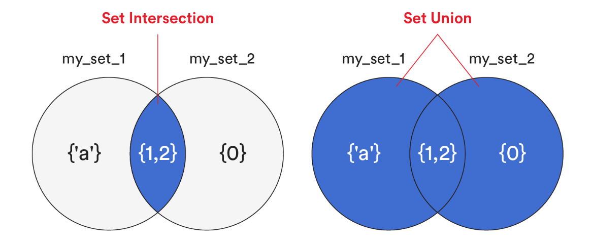
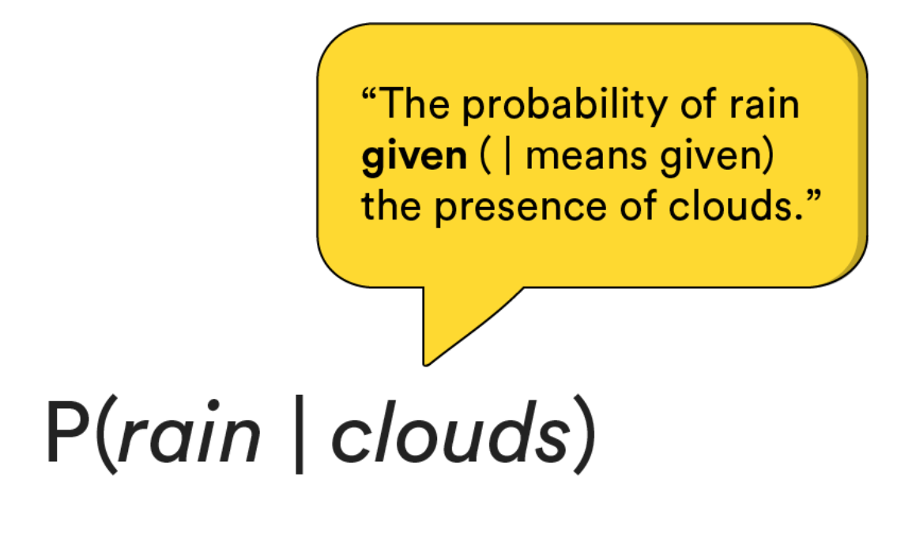
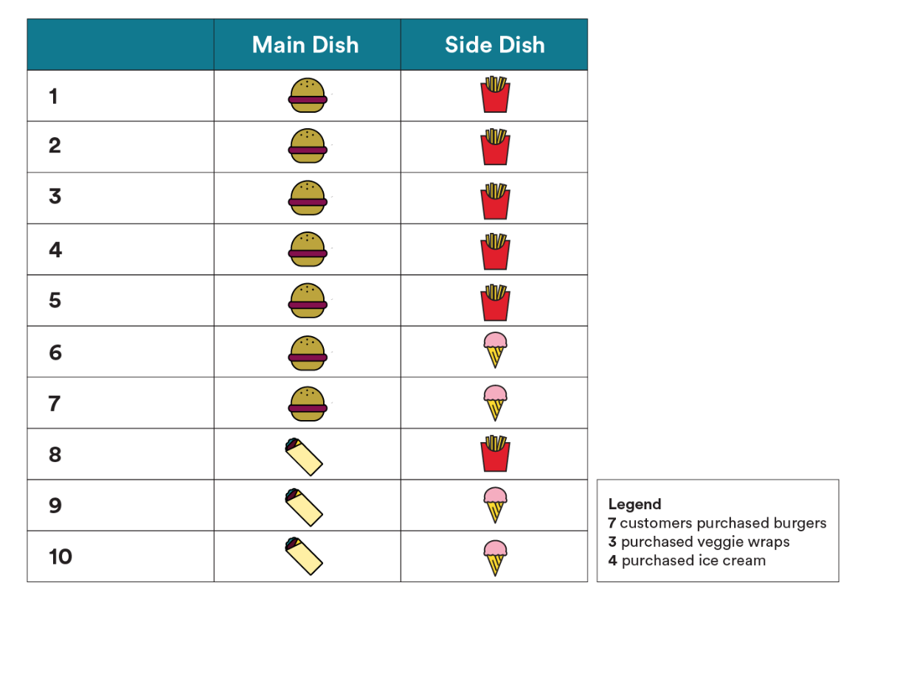

<h1>
  <span class="headline">Math Pre-Work</span>
  <span class="subhead">Rules of Probability</span>
</h1>

## Rules of Probability ( 30 min )

You’ve got a six-sided die and some time to kill. What’s the likelihood that you’ll roll a 3? A 5? How about a 2? In this lesson, we’ll review some of the foundational concepts of probability — i.e., the likelihood of an event occurring.

## Topics

- Set Theory
- Rules of Probability
- Joint Probability
- Conditional Probability

### **Learning Objectives**

By the end of this lesson, you'll be able to:

- Define the rules of probability using real-world examples.
- Explore set theory and implement it in Python.
- Implement marginal, conditional, and joint probability with scenario-based examples.

## Probability IRL

Let’s say you’re watching the news and the weather report comes on.

Would you ever hear the phrase,

*“There’s a negative 12% chance of rain”?*

Or,

*“There’s a 130% chance of rain”?*

...we’re guessing you wouldn’t.

Those phrases don’t exist because of the **rules of probability**.

## Three Rules of Probability

There are three rules of probability that are always true:

1. The probability (likelihood) of an event can’t be less than 0. That’s why you’d never hear, *“Negative 12% chance of rain.”*
2. The probability of an event can’t be greater than 1. That’s why you’d never hear, *“130% chance of rain.”*
3. The union (or sum) of all possible, mutually exclusive outcomes must equal 1.

Let’s make an example of No. 3. Let’s say you have a fair coin:

- There are two possible *outcomes*: heads or tails.
- The probability of each is 50%, or 0.5.
- The *union* of these two possible events is 0.5 + 0.5 = 1.

## Set Theory

Probability relies on something called **set theory**.

A [set](https://docs.python.org/3.8/library/stdtypes.html#set) is a built-in data structure within Python. It’s an unordered collection of distinct hashable objects. You might use sets for things such as membership testing, removing duplicates from a sequence, and computing certain mathematical operations.

There are two approaches to use when creating a set:

Curly braces:

```python
In [1]: my_set_1 = {2, 'a', 2, 1}
   ...: my_set_1

Out[1]: {1, 2, 'a'}
```

Using the built-in `set()` function with an iterable as an argument:

```python
In [1]: my_set_2 = set(range(3))
   ...: my_set_2

Out[1]: {0, 1, 2}
```


## Set Intersection and Set Union

The **set intersection** of two sets is where you have the elements that both have in common.

A **set union** is all of the distinct elements in either set.



We can find the **intersection** of `my_set_1` and `my_set_2` as follows:

```python
In [1]: my_set_1 = {2, 'a', 2, 1}
   ...: my_set_2 = set(range(3))
   ...: my_set_1.intersection(my_set_2)

Out[1]: {1, 2}
```

And here’s how we’d find the **union**:

```python
In [1]: my_set_1 = {2, 'a', 2, 1}
   ...: my_set_2 = set(range(3))
   ...: my_set_1.union(my_set_2)

Out[1]: {0, 1, 2, 'a'}
```


## Three Types of Probability

Just as there are three rules of probability, there are three types of probability, too.

1. **Marginal probability**: The likelihood of a single event occurring, independent of any other events happening before or after it.
2. **Joint probability**: The likelihood of two random events happening together, where the occurrence of one does not affect the occurrence of the other.
3. **Conditional probability**: The likelihood of two events happening together, where the occurrence of one affects the occurrence of the other.

Let’s explore all three...

### Marginal Probability: Airline Travel

We’ll take a closer look at **marginal probability** — the likelihood of a single event occurring, independent of any other events happening before or after it.

Let’s say you’re traveling for the holidays and you’ve got a flight to catch. You want to bring a fancy jar of peanut butter with you as a gift for one of your relatives. You chose not to check your suitcase and decided to pack the peanut butter in your carry-on bag instead. Risky move.

You’re in an airport security line and you see that, in the past five minutes, **35** people have passed the security checkpoint and **2** have been randomly selected for a bag search.

## Joint Probability: Shipping Medical Devices

Next, let’s take a look at joint probability — i.e., the likelihood of two *random* events occurring together — in a real-world scenario…

You’re working at a medical device company where an outgoing shipment of syringe, pill, and surgical-scissor boxes should have received a safety label. However, due to a labeling machine malfunction, almost half of the boxes don’t have a safety label at all! The company may have to pay huge fines, and management needs to know the risk exposure so that it can budget for a recall.

You found out that the occurrence of a label being applied to a box is independent of what product is actually inside of the box. In other words, the labeling machine was just as likely to mislabel a box of syringes as it was a box of pills (for example).

How would you find the probability of a box being shipped without the correct safety label?

There are two factors here, making it a **joint probability** problem:

- The probability that our product is a box of syringes, pills, or scissors.
- The probability that our label machine didn’t label a box at all.

### Joint Probability: Shipping Medical Devices (Cont.)

Here are some key factors to consider...

**Products**

The company has three products it ships from this location:

- Syringes 💉 = 10% of the product volume.
- Pills 💊 = 70% of the product volume.
- Surgical scissors ✂️ = 20% of the product volume.

**Label Machine**

The label machine was loaded with a new roll of 10,000 labels at the start of the shift. After processing 8,000 boxes, you counted 2,200 labels remaining on the roll. Each box should have had a single label.

Let’s take a closer look at the syringes — what was the probability of a box of syringes being shipped without a safety label?

With joint probability, we find the product of two random events by getting the *product of their probabilities*.

**Event No. 1**

The first probability is the likelihood of the product being a box of syringes. Because it’s 10% of the product volume, this is 10%, or 0.1.

**Event No. 2**

The second probability is the likelihood of the label machine failing to label a product (regardless of what product it was). Because we expected 8,000 labels to be consumed during our shipment but only used 7,800 labels (10,000 - 2,200), our probability of failing to label is 200 / 8,000 = 0.025 (2.5%).

That brings us to a *joint* probability of 0.1 * 0.025 = 0.0025 (0.25%).

To sum this up, there was a quarter percent (or **1 in 400**) chance of not labeling a box of syringes.

## Conditional Probability

Is there a known correlation between two events? If so, you’ve got **conditional probability**.

Conditional probability is the same as joint probability, except that the *occurrence of one event affects the likelihood of the other event*.

Let’s consider the connection between cloud cover and rainfall. We know that rain comes from clouds, so we’d expect to see an increased chance of rain when we have an increased chance of clouds.

The probability of rain is **conditional** upon the chance of clouds.

When writing this out, it would look and sound like...



## Conditional Probability (Cont.)

Why is this important?

Let’s say we’ve landed on an alien planet and our community has elected us to be in charge of agriculture. We want to know the chance of rain, given that clouds are present.

However, all we know is:

- The probability of clouds being present, and...
- The probability of *both* rain *and* clouds at the same time.

To solve this, we can use the following formula for conditional probability:

$P(rain∣clouds)= \frac{P(clouds)}{P(rain∩clouds)}$ 

Assuming that we have cloud cover 15% of the time and we have *rain and clouds* 9% of the time, we have:

$P(rain∣clouds)= \frac{0.15}{0.09}$
 
$P(rain∣clouds)=60%$

This means that, assuming we have clouds present, we have a **60%** chance of rain.

## Conditional Probability: Burger Joint

You manage a chain of burger joints selling burgers, veggie wraps, fries, and ice cream. Business has been slow in recent months and you want to boost sales.

There are standard ice cream machines in all of your locations, but you’re considering replacing them with the SuperTurboX Ice Cream machine. These babies pump out ice cream much faster than the standard machines and will allow more customers to move quickly through lines during the lunch hour rush.

To justify this investment, you want to know the current likelihood that a customer will order an ice cream (🍦) given that they have ordered a burger (🍔) before.

Here’s what you know about customer transactions:

- All customers order a main dish of either burgers (🍔) or veggie wraps (🌯).
- All customers order a side dish of either ice cream (🍦) or fries (🍟).

This data is represented in this spreadsheet (pictured below) of 10 customer transactions you’ve pulled from one of your stores.

Looking at this data, given that a customer orders a burger, what is the probability that they’ll order an ice cream?



<br>


## Conditional Probability: Burger Joint (Cont.)

To solve this, we need to know the probability of customers ordering an ice cream and a burger.

We can use our **conditional probability** formula here:

$P(icecream∣burger)= \frac{P(burger)}{P(icecream∩burger)}$

For the solution, we need two things:

- The probability of ice cream *and* a burger.
- The probability of a burger.

To get the probability of ice cream and a burger, we select Rows 6 and 7. Because we have two rows out of 10 transactions, that’s a 20% 
likelihood:

```python
In [1]: icecream = { 6, 7, 9, 10 }
     ...: burger = { 1, 2, 3, 4, 5, 6, 7 }
     ...: icecream.intersection(burger)

Out[1]: {6, 7}
```

To get the probability of just a burger, we select Rows 1 through 7. Because that’s 7 of 10 transactions, that’s a 70% likelihood.

## Conditional Probability: Burger Joint (Cont.)

Plugging the two into our formula:

$P(icecream∣burger)= \frac{0.7}{0.2}$
 
$P(icecream∣burger)=28.6%$

Ultimately, if the customer orders a burger, they’re **28.6%** likely to order ice cream.

Now that you’ve figured this out, you have one question to answer: Should you order the SuperTurboX Ice Cream machine? Decisions, decisions, decisions.


## Up Next...

After some knowledge checks we will look at Vectors in Python.


<br>

<hr>
<a href="./assets/rules-of-probability.pdf" target="_blank" download="rules-of-probability.pdf" class="ant-btn" data-trackable="true" data-track-category="study guide" data-track-section="lesson page" data-track-action="download study guide"><span role="img" class="anticon"><svg viewBox="0 0 16 16" width="1em" height="1em" fill="currentColor" aria-hidden="true" focusable="false" class=""><g class="download_svg__nc-icon-wrapper"><path d="M8 12c.3 0 .5-.1.7-.3L14.4 6 13 4.6l-4 4V0H7v8.6l-4-4L1.6 6l5.7 5.7c.2.2.4.3.7.3z"></path><path data-color="color-2" d="M1 14h14v2H1z"></path></g></svg></span><span> Download Study Guide</span></a>

<br>
