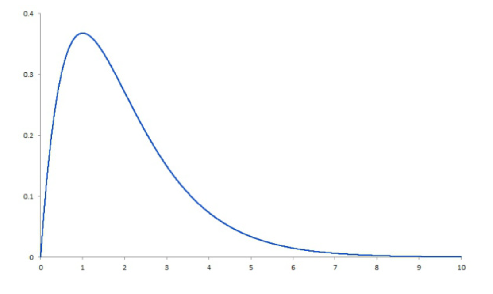

<h1>
  Math Pre-Work
  Random Variables and Expected Value
</h1>

## Random Variables and Expected Value ( 25 min )

*author: [Matt Brems](https://www.linkedin.com/in/matthewbrems/) | Lead Instructor, Data Science Immersive, Washington, D.C.*

----
 

WWhen you're working with different variables, how can you tell which ones are normal (or expected) and which ones are out-of-the-blue random? In this lesson, we’ll teach you how to identify and analyze random and expected values.

## Topics

- Random Variables
- Discrete vs. Continuous Random Variables
- Expected Value

### **Learning Objectives**

By the end of this lesson, you'll be able to:

- Define a random variable.
- Differentiate between a discrete random variable and a continuous random variable.
- Explain the expected value of a random variable.

## What are Random Variables?

**Random variables** are numerical outcomes of a chance event. They're important when quantifying an outcome for a random process.

Suppose you flip a coin three times and count the number of times that the result is heads. Let 
$X$ represent this count.

$X$ can equal 0, 1, 2, or 3 because it is possible for us to flip heads zero, one, two, or three times.  $X$ is the random variable here. It represents the outcome of your experiment (flipping three coins) with a number (how many heads you flipped).

Once a categorical outcome is quantified, we can work with different forms of probability and statistics from that outcome.

## Distribution of Random Variables

The **distribution of a random variable** describes *all possible values* of a random variable and *how likely that variable is to take on each of those values*.

Returning to our coin flip example — you flipped a coin three times and recorded the number of heads that resulted. The table below lists all possible values of our random variable, $X$ (0, 1, 2, 3), and how likely $X$ is to take on each value (0.125, 0.375, 0.375, 0.125):

Assuming this coin is fair and that each flip is independent of the others, we can derive the probability of each outcome:

| $P(X=0)$ | $P(X=1)$ | $P(X=2)$ | $P(X=3)$ |
|------------|------------|------------|------------|
|  0.125  |  0.375  |  0.375  |  0.125  |

----

We call this the *distribution* of a random variable. If we know the distribution of a random variable, we can answer nearly every potential question we have about $X$, such as:

- If we were to flip a coin three times, what is the probability of observing at least two heads?

- If we were to flip a coin three times, how likely is it that we observe exactly one head?

- If we were to flip a coin three times, what is the probability of seeing either all heads or all tails?

## Distribution of Random Variables IRL

Let’s check out some real-world examples.

Suppose we record the number of free throws a basketball player shoots over a season and let $Y$ represent the number of shots successfully made.

- If we were to analyze the data, what is the probability that a randomly selected player makes 80 percent or more of their attempted free throws?

- If we were to analyze the data, what proportion of players make less than 60 percent of their shots and at least seven of the first 10 they attempt?

Can you see how a coach could use this information to better understand how well their players perform throughout a season?

### Discrete vs. Continuous Random Variables

Nearly all random variables fit into one of two categories: **continuous** and **discrete**.

- If you can list out all of the possible values of a random variable, we call that random variable **discrete**.

- If you *cannot* list out all of the possible values of a random variable, we call that random variable **continuous**.

 

## Discrete Random Variables

Let’s refer back to our earlier example of a random variable, 
$X$, where $X$ is the number of heads resulting from a coin flip experiment.

In this case, $X$ is **discrete** because you can list all values of 
$X$ (0, 1, 2, 3).

Now, let's also consider our earlier example of a random variable, $Y$, where $Y$ is the number of free throws made by a player.

In this case, $Y$ is **discrete** because you can list all values of 
$Y$ (all of the possible shots made).

In a nutshell, if you can list out all of its possible values — even if it’s a very large number with thousands of integers — then your random variable is discrete.

## Continuous Random Variables

Let’s say that there is a random variable, $Z$, where $Z$ is the systolic blood pressure of an individual.

In this case, $Z$ is **continuous** because you cannot list all possible values of $Z$.

For example, someone could have a systolic blood pressure of 120, or 120.1, or 120.01, or 120.001, and so on. You wouldn’t be able to write out all possible values of their blood pressure.

## More on Continuous Random Variables

Another example of a continuous random is one that represents the distance between two objects. Because distance could be any value between zero and infinity, this random variable would be considered **continuous**.

In the image below, as the x axis approaches 10, it appears that the y axis reaches zero. However, it will actually just become an increasingly smaller number on into infinity — 0.001, 0.0001, 0.00001, 0.000001, and so on.

 

## Summaries of Distributions

We generally represent a distribution with a table or histogram. These tell us a lot about the behavior of a random variable. For example:

|$P(X=0)$|$P(X=1)$|$P(X=2)$|$P(X=3)$|
|----|----|----|----|
|0.125|0.375|0.375|0.125|

----

However, you might be interested in finding ways to communicate information about this distribution without using these representations.

## Expected Value

There are many different distribution summaries that you'll get to know, but we'll be focusing on **expected value**—the *average value* of a random variable.

We calculate expected value a bit differently for continuous and discrete distributions.

## Expected Value of Discrete Distributions

Take the random variable, $X$, where $X$ is the number of heads observed when we flip a coin three times. We know from before that $X$ can take on the values 0, 1, 2, and 3. The expected value of $X$ — denoted $E[X]$ — is 1.5.

It’s not *quite* as easy as just averaging 0, 1, 2, and 3. In this case it happens to work, but typically it won’t. Consider if $X=3$ occurred 90 percent of the time. If so, do we think we’d want the expected value to be 1.5 or higher?

## Calculating The Expected Value of Discrete Distributions

The formula for calculating the expected value of some discrete random variable $X$ is:

$$
E[X]=\displaystyle\sum_{i=1}^n x_i⋅P(X=x_i)
$$
 
 In this case, $X$ is the random variable itself and $X_i$ are the different values of $X$. We take each value of $X$, multiply it by the probability of observing that particular value of $X$, and sum these products.

## Expected Value of Discrete Distributions (Cont.)

Lets use that formula for calculating the expected value of a discrete random variable, $X$:

$$
E[X]=\displaystyle\sum_{i=1}^n x_i⋅P(X=x_i)
$$

And our table of values of $X$ and their associated probabilities:

|$P(X=0)$|$P(X=1)$|$P(X=2)$|$P(X=3)$|
|----|----|----|----|
|0.125|0.375|0.375|0.125|

Now, let’s calculate the expected value of $X$ here:

$$
E[X]=\displaystyle\sum_{i=1}^n x_1⋅P(X=x_i)\\
    =0⋅P(X=0)+1⋅P(X=1)+2⋅P(X=2)+3⋅P(X=3)\\
    =0⋅0.125+1⋅0.375+2⋅0.375+3⋅0.125\\
    =0+0.375+0.75+0.375\\
    =1.5
$$

## Finding The Expected Value of Continuous Distributions

To find the expected value of a continuous random variable, we’ll need to integrate. In other words, we’ll need to find the probability of each given point and solve for the cumulative sum of all those values.

Recall the formula for expected value applied to a discrete random variable:

$$
E[X]=\displaystyle\sum_{i=1}^n x_i⋅P(X=x_i)
$$

In the case of a continuous random variable, we can’t calculate $x_i⋅P(X=x_i)$ for each $i$ — there's an uncountably infinite number of $i$s!

So, for a continuous random variable, $X$, the formula is:

$$
E[X]=\int_{-\infty}^\infty x⋅f(x)
$$

where $f(x)$ is the probability density function for the random variable $X$.

## Wrap up

Interested in some further topics?  Check out

- [Calculus](https://brilliant.org/courses/calculus-done-right/)
- [Random Variables](http://www.mathsisfun.com/data/random-variables.html)
- [Continuous Variables](http://www.mathsisfun.com/data/random-variables.html)
- [Mean Variance](http://www.mathsisfun.com/data/random-variables-mean-variance.html)

## Up Next...

After some knowledge checks we will look at Measures of Center and Spread.