<h1>
  <span class="headline">Math Prework</span>
  <span class="subhead">Vectors in Python</span>
</h1>

## Vectors in Python ( 30 min )

*author: [Dan Wilhelm](http://danwilhelm.com/) | AI & Data Science Consultant*

----
<br>

What do shirt sizes, education levels, and music genres all have in common? They’re all examples of ordinal categorical data attributes. In this lesson, we’ll explore working with categorical data using vectors, which lets us perform basic operations in Python.

## Topics

- Vectors and Scalars
- Magnitude and Direction

### **Learning Objectives**

By the end of this lesson, you'll be able to:

- Represent vectors as coordinate points and magnitude/direction.
- Vectorize categorical data.
- Calculate basic vector operations.
- Compute and conceptualize normalized vectors.

## Why Linear Algebra?

<a href="https://generalassembly.wistia.com/medias/5meayxool0"></a>


## Scalars and Vectors

You work for Airbnb Experiences, and you want to evaluate the search logs (i.e., clicks) of users who ended up making bookings. Let’s say you’re looking at one feature. Did a user click on the “Experiences” tab? That would be a **scalar** quantity.

What if you were looking at two or more features? Like the country they were browsing from and the total duration of their visit? You could put those together to create a **vector** quantity.

## Scalars

Taking this a bit further…

Let’s say your friend bought a new Segway. They’re cruising along at eight miles per hour on Oak Street.

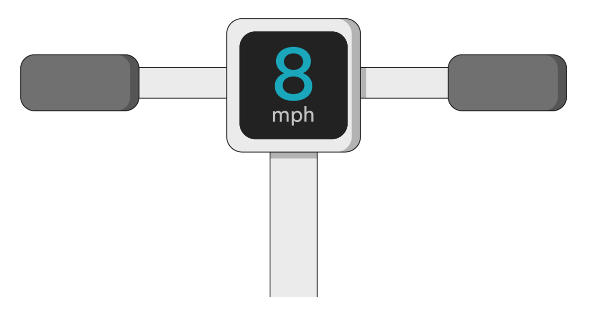

<br>

That 8 MPH — their speed — gives us one piece of data.

Speed, like that single MPH digit, is a **scalar** quantity. It only indicates magnitude without specifying direction.

**Scalars** are single numbers. They’re measurements with magnitude but not direction, such as length, distance, and speed. You’ll usually see them written as non-bold, lowercase characters.

In Python, we could represent a scalar, such as the speed of 8 MPH, as an int or float value:

```python
In [1]: friend_speed = 8
   ...: friend_speed

Out[1]: 8
```

## Vectors

Update! You’ve just learned that your friend is traveling south down Oak Street. Now, not only do you have a scalar quantity — the speed of 8 MPH — you’ve got a direction of travel, too.

Those two pieces of information together — the magnitude and the direction — yield their velocity. Velocity is an example of a **vector** quantity.

A **vector** is a list of numbers. You can interpret what that list of numbers means as either identifying a point in space or as both a magnitude and a direction.

If you see a list of numbers enclosed in parentheses or brackets, or a lowercase letter with an arrow on top, you can assume it’s a vector. In this lesson, we’ll denote vectors as bold, lowercase letters.

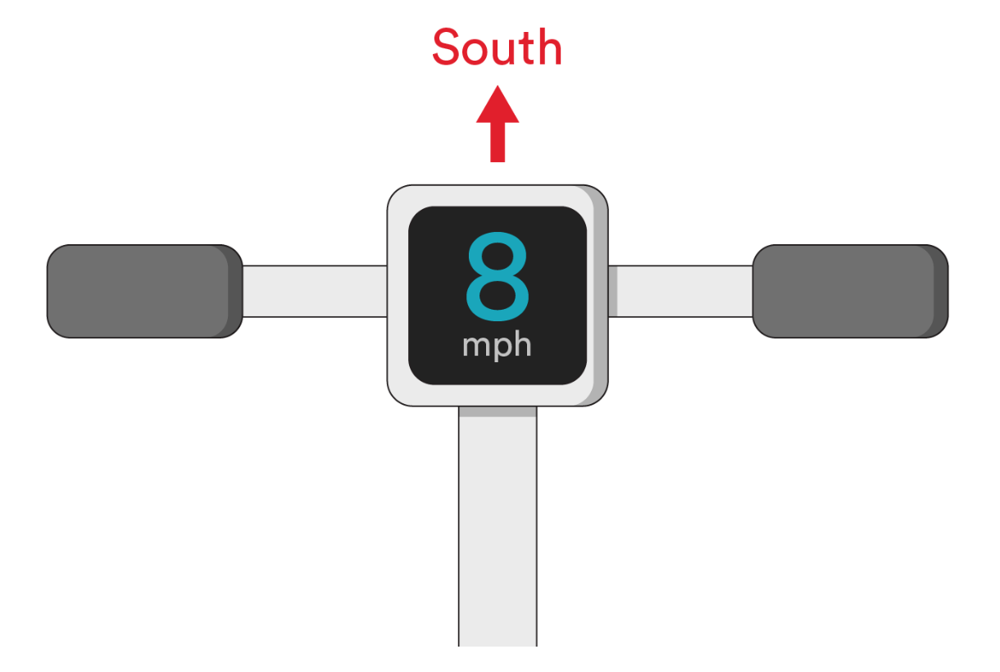

<br>

Going back to Python, we could represent a vector as a list:

```python
In [2]: friend_velocity = [8, 'South']
   ...: friend_velocity

Out[2]: [8, 'South']
```

## Vectorizing Data

What happens if the attributes you have aren’t numeric? How would you write a vector from that? For example, what’s `Apple` plus `Kiwi`?

Linear algebra calculations can’t operate on non-numeric data. That’s where vectorizers come in. Any function that takes non-numeric input and returns numeric vectors is referred to as a **vectorizer**.

There are two primary vectorizing techniques that allow us to process non-numeric data.

Let’s take a closer look at them...

### Label Encoding

One way of vectorizing your data is called [label encoding](https://scikit-learn.org/stable/modules/generated/sklearn.preprocessing.LabelEncoder.html) — assigning numerical values to each attribute.

Let’s use that `Apple` plus `Kiwi` example to illustrate this technique:

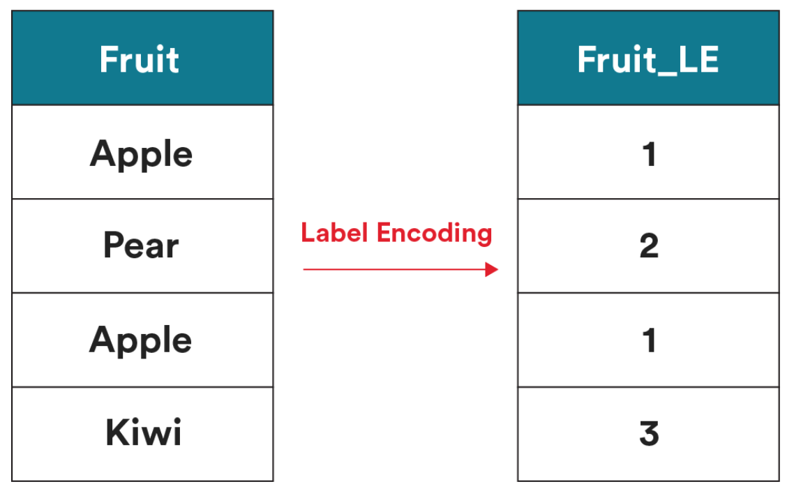

<br>

Now, if we revisit `Apple` plus `Kiwi`, we’ve got an answer: 4.

## One Hot Encoding (OHE)

Another common technique for vectorizing categorical data is called [one-hot encoding](https://scikit-learn.org/stable/modules/generated/sklearn.preprocessing.OneHotEncoder.html) (sometimes abbreviated as “OHE”).

Let’s see what a transformation looks like:

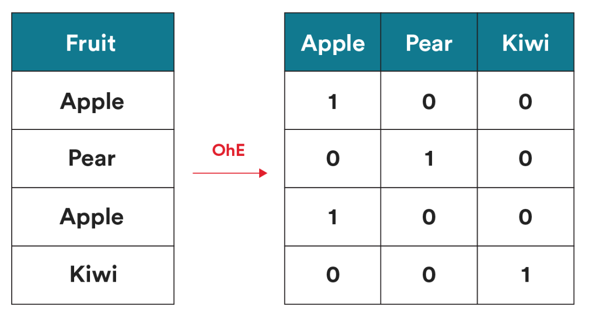

<br>

When you use OHE, you’re guaranteed a binary array (only 1s and 0s as the values) as an output.

This is helpful when you’re processing a data set with an extremely large number of features, because those features can be converted to a [compressed sparse array](https://docs.scipy.org/doc/scipy/reference/generated/scipy.sparse.csr_matrix.html), allowing you to store a greater number of features than your computer has room to fit in memory.

If you had a single feature in your data that has $n$ possible categories, for regression models, you’d want to convert this feature into separate scalars — $n−1$ — to vectorize it. This saves some space in memory without any loss of information.

### Vectorization

Let’s try applying OHE to the Olympic swimmer data we talked about earlier.

Suppose an Olympic “sport” feature falls into one of the categories: swimmer 🏊‍♀️, gymnast 🤸‍♀️, or fencer 🤺 ($N=3$).

To vectorize this, we’ll create a tuple with two indices. The 0th index will be $1$ if a swimmer, and $0$ otherwise. The 1st index will be $1$ if a gymnast, and $0$ otherwise. If both the 0th and 1st index are $0$, we can infer the athlete is a fencer:

- Swimmer 🏊‍♀️ will be vectorized as $(1,0)$.

- Gymnast 🤸‍♀️ will be vectorized as $(0,1)$.

- Fencer 🤺will be vectorized as $(0,0)$.

## Scalars, Vectors, and Data Science

In most machine-learning algorithms, each data point must be vectorized — i.e., converted to a vector. Once all data points are vectors, they can be thought of as points in space.

Let’s take that 24-year-old Olympic swimmer, weighing 180 pounds and being 72 inches tall. Each of those attributes is a scalar that measures something.

Together, they can be written as a vector:

$a=(24,180,72)$

### Vectors: Visualization

Visualizing vectors allows us to gain insight into how many algorithms work.

We’ll try this out using a plain-old graph grid to plot some of our Olympic athlete data.

We’ll start by vectorizing each athlete. Suppose you know the age, weight, and sport of four athletes:

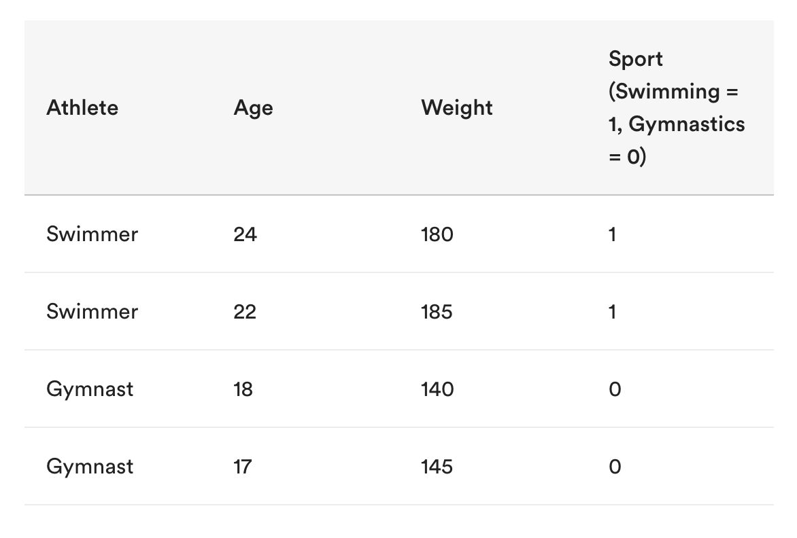

<br>

To visualize this data, we’ll plot their ages and weights as points on a coordinate grid. We end up with two clusters of points: one in the upper-right corner (swimmers) and one in the lower-left corner (gymnasts).

## Classification

We just used different colors to denote the sports, but you could also plot the sport along a third dimension, which brings us to vector **classification**.

Notice that the two clusters can be separated by a line. The purpose of linear algebra is to compute the equation of the line that best separates these two groups.

For our Olympic data, the swimmers could also be classified using only vertical and horizontal lines of being an age older than 20 and/or a weight more than 160, for example.

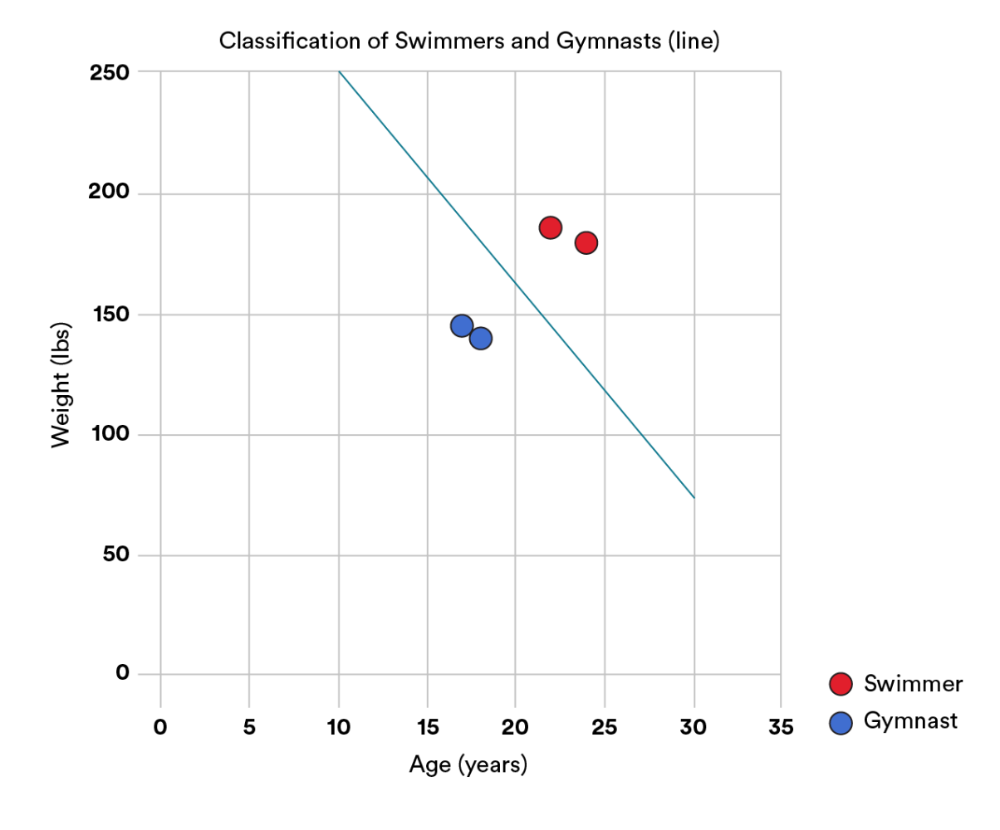

<br>

## Classification and Coefficients

When we say “compute the equation of the line,” we mean to solve for two unknown **coefficients**, $A$ and $B$. (In these lessons, non-bold uppercase letters will denote coefficients, even though coefficients are scalars.) These coefficients satisfy the equation:

$weight=A⋅age+B$

In this case, any value above the line will be classified as a swimmer. Any value below the line will be classified as a gymnast.

How would we do this?

In this case, we have a constraint. We want this line to be as “in between” the two data clusters as possible. So, we’ll find the line where its points are farthest from both clusters. When we express this constraint mathematically, we get a score of how “good” our coefficients are. Using calculus, we can then solve for coefficients that maximize the value of the constraint.


## Parametric Models

The process we just illustrated is used for nearly all **parametric** machine-learning models.

Parametric models rely on mathematical formulas with unknown coefficients or parameters (such as linear regression, logistic regression, and neural networks). They can be helpful because they have a small memory footprint and are generally fairly easy to interpret.

To solve for those unknown coefficients/parameters, parametric models deal with three key factors:

- **Model**: An equation with coefficients for which to solve.

- **Constraint**: Used to determine how “good” a set of coefficients is.

- **Optimization** technique: Finds ideal coefficients.

To put this into context, linear regression is just the **model**. We can utilize different **constraints** and different **optimization techniques** that are independent of that model.

## Parametric Models Exemplified

An example of a parametric model would be if you made a prediction like, *“I think the weight of a person is twice their age.”*

The weight is unknown (what we want to predict) and the age is the input sample (the data we know):

$weight=2∗age$

The size and complexity of parametric models are *independent* of the number of data points (samples) in our data set. It doesn’t matter how many *predictions* you make, the equation of the predicted result remains *fixed*.

## Generalizing Magnitude

So far, we’ve been referring to two- and three-dimensional vectors as 
$(x,y)$ and $(x,y,z)$. However, this notation isn’t helpful for high-dimensional points — we’ll quickly run out of letters.

**Magnitude** helps us to condense a vector for future operations. We can refer to each component of a high-dimensional vector as a subscript of the vector name.

Let’s say we’re taking a survey on the street and want to collect the age, weight, and height of folks walking by.

The first person passes by and we get the following data:

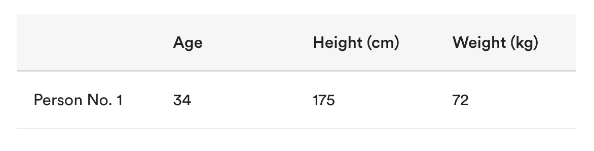

<br>

We could represent this 3D vector in Python as a list:

```python
In [1]: data = [34, 175, 72]
   ...: data

Out[1]: [34, 175, 72]
```

## Generalizing Magnitude (Cont.)

Then, another person approaches and they also give us this data.

When we add it to our data set, it ends up looking like this:

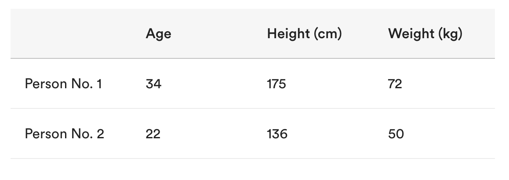

<br>

In Python, we can now represent our data as a *nested* list object:

```python
In [2]: data = [
   ...:     [34, 175, 72],
   ...:     [22, 136, 50]
   ...: ]
   ...: data

Out[2]: [[34, 175, 72], [22, 136, 50]]
```

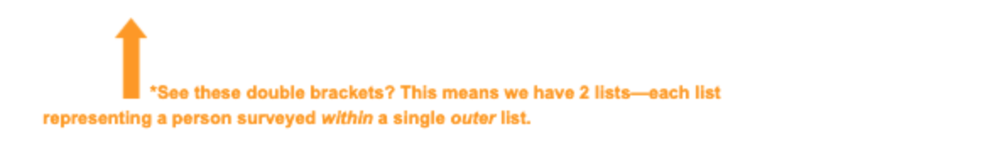

<br>

The $n$ points in an $n$-dimensional vector, $x$, each refer to the offset from $n$ orthogonal axes. We can define the magnitude of the vector $x$ to be:

$||x||= \sqrt{(x_1^2​ +x_2^2​ +...+x_n^2​ )}$
 
The magnitude is the **square root of the sum** of each component squared. Fun fact: This is actually a generalization of the Pythagorean Theorem.

## Normalization

Another common vector concept is **normalization**.

Normalizing a vector finds the vector with magnitude $1$ in the same direction as the original vector.

This is called a **unit vector**, as the vector has a unit length.

Picture a line running through the origin to the vector point. Now, imagine a unit circle — a circle with a radius of $1$ — surrounding the origin. The point of intersection of the line with the unit circle (closest to the vector point) represents the normalized vector. Normalizing a vector means that we’re mapping the vector to a point on the unit circle.

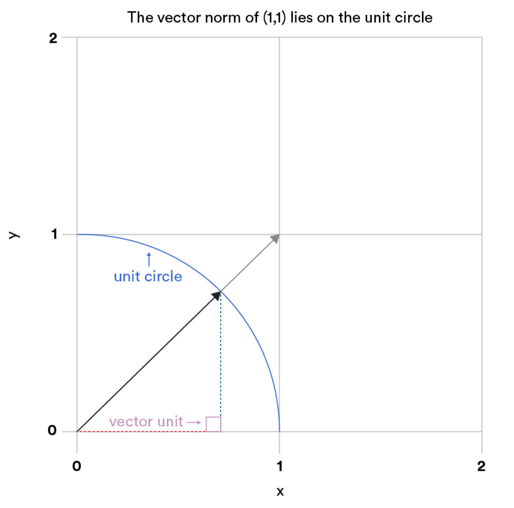

<br>

## Normalizing a Vector

Normalizing a vector means that we’re mapping the vector to a point on the unit circle. To find the unit vector, you’d divide the original vector by its magnitude.

For example, the magnitude of $(1,1)$ is $\sqrt{2}$ .  So, its unit vector is $(1,1)/ \sqrt{2}$ .  The unit vector is often denoted by including a hat above the vector name. So, for an $n$-dimensional vector, $v$:

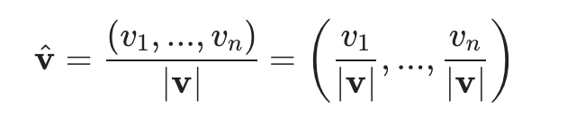

<br>

A unit circle in three dimensions is a **unit sphere**. In higher dimensions, it’s a **unit hypersphere**.

## Normalization in Python

Let’s do a quick example in Python to illustrate normalization.

The math we just covered is wrapped up in a nice little function called `normalize()` within the [scikit-learn library](https://scikit-learn.org/stable/modules/generated/sklearn.preprocessing.normalize.html#sklearn.preprocessing.normalize).

If we apply this to our Olympic athlete age, height, and weight data from earlier:

```python
In [1]: from sklearn.preprocessing import normalize
   ...: data = [
   ...:     [34, 175, 72],
   ...:     [22, 136, 50]
   ...: ]
   ...: normalize(data, axis=0)

Out[1]:
array([[0.83957016, 0.78959511, 0.82136997],
       [0.54325128, 0.6136282 , 0.57039581]])
```

Here, what we’ve done is normalized our data on a *per-column* basis (see the `axis=0` argument). This means our age (`34`, `22`), height (`175`, `136`), and weight (`72`, `50`) have all been normalized based on the data in their respective columns. The outputs are bound between `0` and `1` and have unit-norm length.

## Multiplying a Vector By a Scalar

Multiplying a vector by a scalar actually **scales the vector**, changing its magnitude but not its direction.

To multiply a vector by a scalar, you’ll multiply *each* component of the vector by that scalar.

In the visual below, a line is drawn from the origin through the vector point.

- Multiplying the vector by one-half corresponds to the point halfway between the point and the origin.
- Multiplying it by two corresponds to the point twice as far from the origin.

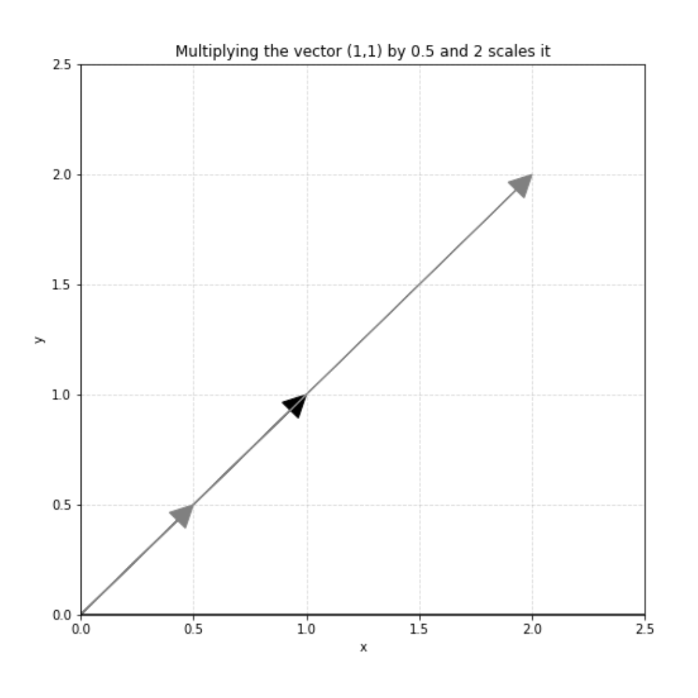

<br>

## Vector Addition

**Vector addition** is used in many algorithms. This same element-wise technique also applies to vector subtraction.

Going back to our Olympic athlete data, let’s say there's a 24-year-old athlete who weighs 160 pounds and is 72 inches tall. We'd vectorize this as $(24,160,72)$.

One year later, that athlete is a year older and loses five pounds — we’ll vectorize the displacement as $(1,−5,0)$.

By adding these two vectors together component by component, we get the athlete’s final stats, using the “delta” symbol ($Δ$) to indicate a change:

$$a+Δa=(24,160,72)+(1,−5,0)\\
=(24+1,160−5,72+0)\\
=(25,155,72)$$

The final athlete is 25 years old, 155 pounds, and 72 inches tall.

## Vector Addition in Python

Let’s try that in Python with our age, height, and weight data. For this, we’ll need the help of [NumPy](https://numpy.org/doc/stable/reference/generated/numpy.add.html), which is a linear algebra library for Python:

```python
n [1]: import numpy as np
   ...: data = np.array([
   ...:     [34, 175, 72],
   ...:     [22, 136, 50]
   ...: ])
   ...: tens = np.array([
   ...:     [10, 10, 10],
   ...:     [10, 10, 10]
   ...: ])
   ...:
   ...: np.add(data, tens)

Out[1]:
array([[ 44, 185,  82],
       [ 32, 146,  60]])
```

## Dot Product

Let’s explore multiplying a vector by a vector...

You’ll often see a multiplication (centered dot, $⋅$ ) symbol used between two vectors. This is an operation known as the **dot product**.

The dot product is the sum of the products of each pair of components.

For example, suppose $x=(1,2,3)$ and $y=(4,5,6)$. That means:

$x⋅y=1⋅4+2⋅5+3⋅6=4+10+18=32$

## Dot Product in Python

Let’s work through this example with NumPy:

```python
In [1]: import numpy as np
   ...: x = np.array([1, 2, 3])
   ...: y = np.array([[4], [5], [6]])
   ...:
   ...: np.dot(x, y)

Out[1]: array([32])
```

Now, suppose $x=(1,0)$ and $y=(0,1)$. In this case, the dot product is  $0$.

Below is the mathematical formulation of this (subscripts indicate components):

$$
\mathbf{v}⋅\mathbf{w}=\displaystyle\sum_{i=1}^n v_iw_i+ v_1w_1+ ...+ v_nw_n
$$

The vectors here are at a 90-degree angle, and the dot product is $0$. This is because the dot product is related to the angle between vectors.

## Wrap up

We’ve covered what scalars and vectors are and how we can represent categorical data. As you move forward in the course, remember that vectors and matrices help to build the foundation for linear regression.

If you want to learn more, check out the following resources:

- [Scalar Vector Matrix](http://www.mathsisfun.com/algebra/scalar-vector-matrix.html).

- [Vector Dot Product](http://www.mathsisfun.com/algebra/vectors-dot-product.html).

## Up Next...

After some knowledge checks we will look at Matrix Operations in Python.

<br>

<hr>

<a href="./assets/vectors-in-python.pdf" target="_blank" download="vectors-in-python.pdf" class="ant-btn" data-trackable="true" data-track-category="study guide" data-track-section="lesson page" data-track-action="download study guide"><span role="img" class="anticon"><svg viewBox="0 0 16 16" width="1em" height="1em" fill="currentColor" aria-hidden="true" focusable="false" class=""><g class="download_svg__nc-icon-wrapper"><path d="M8 12c.3 0 .5-.1.7-.3L14.4 6 13 4.6l-4 4V0H7v8.6l-4-4L1.6 6l5.7 5.7c.2.2.4.3.7.3z"></path><path data-color="color-2" d="M1 14h14v2H1z"></path></g></svg></span><span> Download Study Guide</span></a>

<br>
